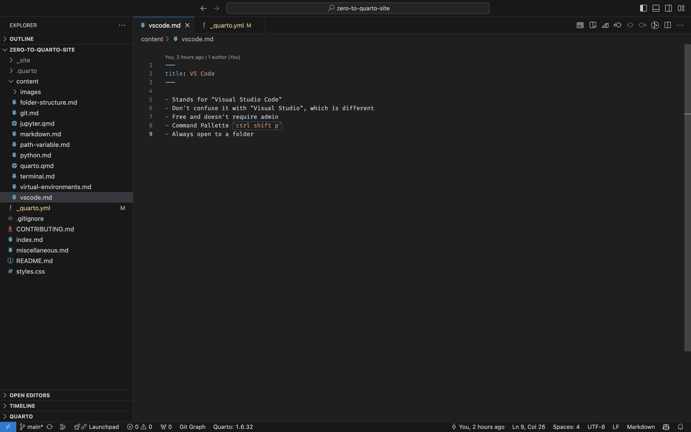
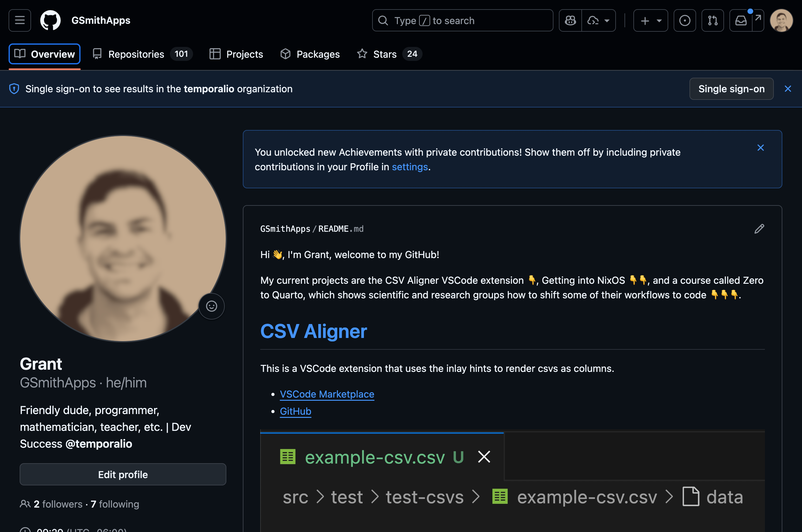

## Install Visual Studio Code

- [ ] Install Visual Studio Code (usually called to "VS Code").
- Don't confuse it with "Visual Studio", which is different
- Free and doesn't require admin

This is what VS Code looks like:

---

## GitHub Account

Github is a website that's like Google Drive
mixed with a social network. Programmers use it to
keep and share their code.

- [ ] Make a GitHub account
- It's free and no spam etc

---

## Google Account

- [ ] Have a google/gmail account (probably optional, but recommended)
- Also free
